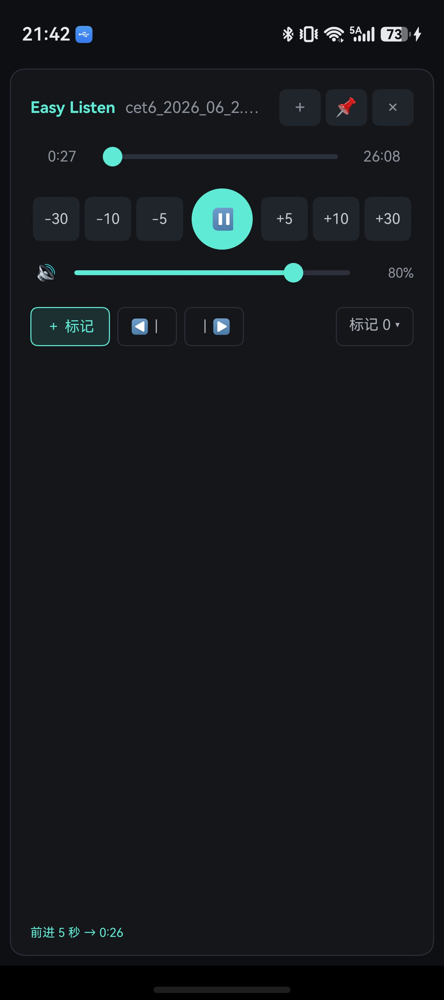

# Easy Listen（HarmonyOS）

一个用于「边阅读边听」的鸿蒙单文件音频播放器。移植自 Easy Listen 桌面版，界面保持深色悬浮条风格，并针对手机/平板补上了可预导入的音频库。



## 功能

- **音频库**：一次性添加一个或多个音频文件夹，应用递归扫描并记住其中的音频；也可以在库中批量导入零散文件
- **库内搜索**：按文件名实时过滤，配合文件夹筛选，音频再多也能快速定位
- **持久化授权**：文件夹/文件授权写入系统，应用重启或手机重启后仍可直接选播（卸载重装需重新导入）
- **单文件专注播放**：一次只播放一个音频，不会和系统音乐库混淆
- **精确跳转**：`-30 / -10 / -5 / +5 / +10 / +30` 秒按钮，配合进度条拖动
- **位置标记**：一键标记当前位置；标记列表点击跳转；支持「上一个 / 下一个」；按音频 URI 独立保存
- **音量控制**：0–100 级音量，设置持久化
- **应用内快捷键**：键盘聚焦页面时可用 `Space`、`← / →`、`M`

## 支持格式

`mp3`、`m4a`、`aac`、`wav`、`flac`、`ogg`。

解码由系统 `AVPlayer` 负责；`wma`、`opus` 等格式不再支持，导入时会被过滤或提示。

## 快捷键

| 快捷键 | 功能 |
| --- | --- |
| `Space` | 播放 / 暂停 |
| `←` | 后退 5 秒 |
| `→` | 前进 5 秒 |
| `M` | 标记当前位置 |

快捷键仅在音频库关闭、页面获得焦点时生效。

## 音频库使用说明

1. 点击播放页右上角 `＋` 打开音频库；
2. 点击「＋ 添加文件夹」，在系统文件选择器中选择一个音频目录，应用会扫描其中（含子目录）的受支持音频；
3. 重复第 2 步可添加多个文件夹，用顶部文件夹标签切换「全部 / 指定文件夹」；
4. 在搜索框输入文件名关键字即可过滤；
5. 点击条目立即播放；条目右侧 `×` 仅从音频库移除，不删除用户文件。

设备能力说明：

- 文件夹选择依赖系统能力 `SystemCapability.FileManagement.UserFileService.FolderSelection`；
- 目标机型 MRT-AL10（HarmonyOS 7.0.0 / API 26）已支持；
- 不支持该能力的设备会自动隐藏「添加文件夹」，仍可通过「导入音频文件」批量导入。

## 环境要求

- DevEco Studio（HarmonyOS SDK **API 26 / 26.0.0**）
- 已连接并解锁的 HarmonyOS 手机/平板（调试签名需绑定设备 UDID）

## 构建与运行

1. 用 DevEco Studio 打开本项目；
2. `File > Project Structure > Signing Configs`，勾选 `Automatically generate signature` 并登录华为开发者账号（首次需要）；
3. 点击 Run 安装到设备，或使用命令行构建：

```powershell
$env:DEVECO_SDK_HOME = '<DevEco Studio 安装目录>\sdk'
& '<DevEco Studio 安装目录>\tools\hvigor\bin\hvigorw.bat' `
  --mode module -p product=default -p module=entry@default assembleHap --no-daemon
```

签名配置完成时产物为：

```
entry\build\default\outputs\default\entry-default-signed.hap
```

安装与启动：

```powershell
$hdc = '<DevEco Studio 安装目录>\sdk\default\openharmony\toolchains\hdc.exe'
& $hdc install -r 'entry\build\default\outputs\default\entry-default-signed.hap'
& $hdc shell aa start -a EntryAbility -b com.easylisten.harmony
```

> 仓库中的 `build-profile.json5` 默认不包含任何签名材料；签名信息由 DevEco Studio 在本机生成，请勿提交证书、Profile 或密码。

## 目录结构

```
easy-listen-harmony/
├─ AppScope/                       # 应用级配置与图标
├─ entry/src/main/
│  ├─ module.json5                 # 模块、权限声明
│  ├─ ets/
│  │  ├─ entryability/             # UIAbility 入口
│  │  ├─ pages/Index.ets           # 播放页 + 音频库页面
│  │  ├─ model/Types.ets           # 标记、音频库数据结构
│  │  ├─ service/AudioController.ets  # AVPlayer 播放封装
│  │  ├─ service/AudioLibrary.ets     # 文件夹选择、扫描、持久化授权
│  │  ├─ service/LibraryStore.ets     # 音频库 sandbox JSON 存储
│  │  ├─ service/Store.ets            # 标记/设置 preferences 存储
│  │  └─ utils/TimeFormat.ets
│  └─ resources/                   # 字符串、颜色、图标
├─ docs/screenshot.jpg             # 界面截图
├─ build-profile.json5
└─ oh-package.json5
```

## 数据存储

- 标记、音量、置顶状态：`preferences`（store 名 `easy_listen`），标记按音频 URI 区分；
- 音频库（文件夹与文件 URI 列表）：应用沙箱 `filesDir/library.json`；
- 文件夹/文件访问授权：`fileShare.persistPermission` 持久化，启动时 `activatePermission` 激活。

## 平台限制

- 手机/平板上的普通应用无法悬浮在其它应用之上，也无法系统级置顶；置顶按钮会提示「当前设备不支持窗口置顶」；
- 鸿蒙普通应用不支持系统级全局快捷键，只提供应用内快捷键；
- 音频解码能力由系统 `AVPlayer` 决定，不支持 `wma` / `opus`。

## 版本

`0.1.0`
